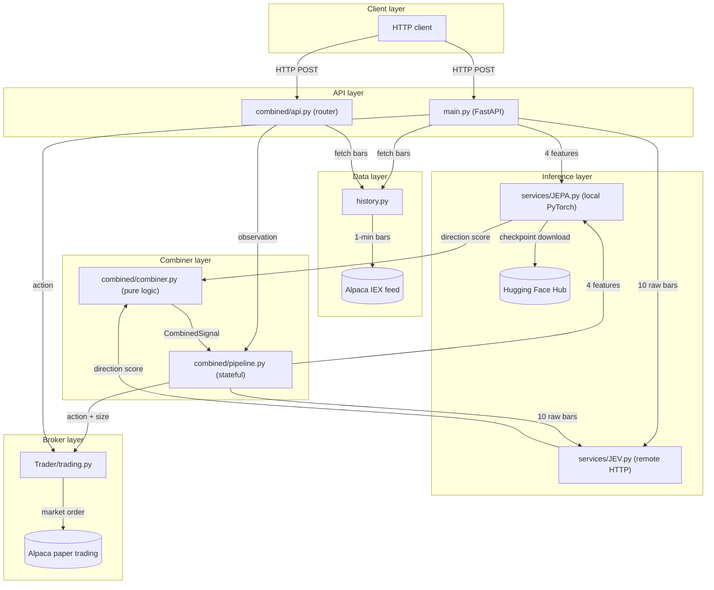

# JEV trading bot

A paper-trading system that combines two AI signal sources — a local PyTorch JEPA model and a remote JEV language-model API — to decide whether to buy, sell, or hold US equities via the Alpaca paper-trading brokerage. It is built on FastAPI, alpaca-py, PyTorch 2.8 (CUDA 12.8), and httpx, with pydantic-settings managing configuration.

## What this project is about

The system addresses the problem of combining heterogeneous AI signal sources for intraday equity trading without look-ahead bias. The JEPA model runs locally and classifies market direction from a 60-step feature window using a patch-embedding transformer; the JEV API sends the last 10 raw minute bars to a remote language model and receives a BUY/SELL/HOLD decision with confidence. Both signals are percentile-normalized over a rolling in-memory history before a rule-based combiner decides whether to act. All order execution targets Alpaca paper trading only; no live-trading endpoints exist.

## Architecture

<!-- mermaid-checked: no \n, no em-dash/en-dash, no {} in labels, subgraphs are id["label"], arrows are -->|"label"| -->


## Capabilities

- Combines JEPA and JEV signals using percentile normalization over a configurable rolling window (default 500 bars), with weighted scoring and rule-based gating (opposite_veto, entry_threshold, solo, warm_up).
- Implements position-aware order logic covering six cases: long entry, long exit, short entry, short cover, hold, and no-trade.
- Loads the JEPA checkpoint from a local `.pt` file specified by `JEPA_CHECKPOINT`, or downloads it automatically from Hugging Face Hub (`sujalgawas/jepa-trading-direction-small`).
- Integrates with an external JEV language-model API via an OpenAI-compatible chat-completions request using the last 10 raw minute bars as context.
- Falls back to a randomly sampled prior weekday historical window when live market data is unavailable outside trading hours.
- Exposes standalone routes for each model (`/jepa_observation`, `/jev_observation`) as well as a combined pipeline route (`/combined/predict`) that runs up to 330 one-minute iterations.
- Includes a `pytest` test suite covering combiner logic, route behavior, and short position handling, all without live API calls.

## Repository structure

| Component | Description |
|---|---|
| `app/` | Root Python package for the FastAPI application. |
| `app/main.py` | FastAPI application entry point; defines standalone JEPA and JEV routes. |
| `app/config.py` | `Settings` class (pydantic-settings); reads all configuration from `.env`. |
| `app/services/JEPA.py` | JEPA model definition (`LOBEncoder`, `TransformerEncoder`, `DirectionHead`) and `JEPAInference` wrapper. |
| `app/services/JEV.py` | `JEVInference` wrapper; sends market state to the remote JEV API and parses BUY/SELL/HOLD. |
| `app/combined/api.py` | FastAPI router mounted at `/combined`; defines `/combined/predict` and `/combined/dummy`. |
| `app/combined/combiner.py` | Pure `combine_predictions()` function; no IO, fully unit-testable. |
| `app/combined/pipeline.py` | `CombinedPipeline` service; maintains per-symbol rolling histories and coordinates model calls. |
| `app/Trader/auth.py` | Factory functions for Alpaca `StockHistoricalDataClient` and `TradingClient`. |
| `app/Trader/history.py` | `get_market_observation()`; fetches 1-minute bars and computes 4 stationary features. |
| `app/Trader/portfolio.py` | Account queries (cash, equity, buying power). |
| `app/Trader/trading.py` | `run_trading_pipeline_jepa()` and `execute_order()`; position-aware order execution. |
| `Research/` | Jupyter notebooks used for JEPA model training and evaluation. |
| `tests/` | `pytest` test suite for combiner logic, route behavior, and short trading. |
| `.env.example` | Template listing all required and optional environment variables. |
| `requirements.txt` | Python package dependencies. |

## Quickstart

### Prerequisites

- Python 3.11.
- A CUDA-capable GPU is recommended; the JEPA model falls back to CPU automatically.
- An Alpaca paper-trading account with API key and secret key.
- A JEV API endpoint URL and API key.
- A Hugging Face account with access token (required only if `JEPA_CHECKPOINT` is not set and the Hub repository is private or gated).

### Run the server

1. Copy `.env.example` to `.env` and fill in all credentials.
2. Create and activate a virtual environment.
3. Install dependencies.
4. Start the server.

```bash
cp .env.example .env
# Edit .env with your Alpaca, JEV, and Hugging Face credentials

python -m venv venv
# Windows:
venv\Scripts\activate
# macOS / Linux:
source venv/bin/activate

pip install -r requirements.txt

uvicorn app.main:app --reload
```

The server listens at `http://127.0.0.1:8000` by default. Visit `http://127.0.0.1:8000/docs` for the auto-generated OpenAPI interface.

## Environment variables

### Core credentials

| Variable | Description |
|---|---|
| `ALPACA_API_KEY` | Alpaca paper-trading account API key. |
| `ALPACA_SECRET_KEY` | Alpaca paper-trading account secret key. |
| `ALPACA_BASE_URL` | Alpaca base URL; use `https://paper-api.alpaca.markets` for paper trading. |
| `JEV_API_KEY` | Bearer token for the remote JEV API. |
| `JEV_API_URL` | Full URL of the JEV chat-completions endpoint. |
| `JEV_MODEL` | Model name passed in JEV API requests (default: `jev-latest`). |
| `HUGGINGFACE_KEY` | Hugging Face access token; required for private or gated Hub repositories. |
| `JEPA_CHECKPOINT` | Local path to a direction-head `.pt` checkpoint; takes precedence over Hub download. |
| `JEPA_HF_REVISION` | Specific Hugging Face commit revision for the JEPA checkpoint. |
| `jepa_train_cutoff` | ISO 8601 datetime string marking the JEPA training data cutoff. |
| `combined_signal_log_path` | Path for the signal log JSONL file (default: `data/combined/signals.jsonl`). |

### Combined pipeline

| Variable | Description |
|---|---|
| `COMBINED_PERCENTILE_WINDOW` | Number of prior bars kept in the rolling percentile history (default: `500`). |
| `COMBINED_JEPA_WEIGHT` | Weight applied to the normalized JEPA score (default: `0.5`). |
| `COMBINED_JEV_WEIGHT` | Weight applied to the normalized JEV score (default: `0.5`). |
| `COMBINED_ENTRY_THRESHOLD` | Minimum combined score magnitude required to open a trade (default: `0.6`). |
| `COMBINED_SOLO_THRESHOLD` | Minimum single-model score magnitude required when only one model is active (default: `0.85`). |
| `COMBINED_MAX_SIZE` | Maximum fractional position size multiplier (default: `1.0`). |
| `COMBINED_WARMUP_PERIOD` | Minimum number of history entries required before percentile normalization is active (default: `2`). |

## Documentation

- [Architecture overview](./docs/architecture.md)
- [API reference](./docs/api.md)
- [Database and data models](./docs/database.md)
- [JEPA service](./docs/jepa.md)
- [JEV service](./docs/jev.md)
- [Combined signal combiner](./docs/combiner.md)
- [Trader module](./docs/trader.md)

## Contributing

See [contribution.md](./contribution.md) for the contributor guide.

