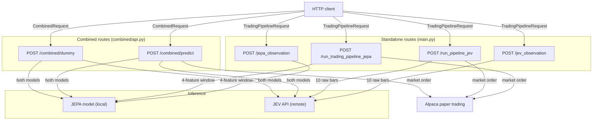

# API reference

All endpoints accept and return JSON. Server-side credentials (Alpaca API key and secret, JEV API key) are configured via environment variables in `.env`; clients do not send Authorization headers to the FastAPI server.

<!-- mermaid-checked: no \n, no em-dash/en-dash, no {} in labels, subgraphs are id["label"], arrows are -->|"label"| -->

## Common response conventions

- `200` — the request succeeded and the response body contains the prediction result or run array.
- `422` — the request body failed Pydantic validation; for example, `quantity` ≤ 0 or `symbol` is an empty string.
- `503` — a downstream dependency is unavailable: the JEPA checkpoint file was not found on disk and could not be downloaded from Hugging Face Hub, or the JEV API returned a non-2xx HTTP status.
- The `action` field in trading result objects is one of `"buy"`, `"sell"`, `"hold"`, or `"error"`.
- Pipeline routes (`/run_trading_pipeline_jepa`, `/run_pipeline_jev`, `/combined/predict`) return a top-level `runs` array; each element has `"iteration"` (1-indexed integer) and `"result"` (the trade outcome dict).
- `/combined/predict` blocks synchronously for up to 330 minutes (one 60-second sleep between each of 330 iterations); do not use it behind a proxy with a short request timeout.
- `/combined/dummy` runs both models on a randomly sampled prior weekday historical window and returns a flat combined prediction dict without submitting an order.

## Endpoint index

| Method | Endpoint | Purpose |
|---|---|---|
| `GET` | `/` | Health check; returns `{"message": "backend is working"}`. |
| `GET` | `/test_env` | Returns current account cash, equity, buying power, and trading block status. |
| `POST` | `/jepa_observation` | Runs the JEPA model on live (or fallback dummy) market data and returns a direction prediction. |
| `POST` | `/jev_observation` | Calls the JEV API on live (or fallback historical) market data and returns a direction prediction. |
| `POST` | `/run_trading_pipeline_jepa` | Runs 120 one-minute JEPA-driven trading iterations with live order execution; blocks for up to 120 minutes. |
| `POST` | `/run_pipeline_jev` | Runs a single JEV-driven trading iteration with live order execution. |
| `POST` | `/combined/predict` | Runs 330 one-minute combined (JEPA + JEV) trading iterations with live order execution; blocks for up to 330 minutes. |
| `POST` | `/combined/dummy` | Tests both models on prior-day historical data and returns the combined signal without placing an order. |

## Request body fields

### `TradingPipelineRequest`

Used by `/jepa_observation`, `/jev_observation`, `/run_trading_pipeline_jepa`, and `/run_pipeline_jev`.

| Field | Type | Default | Notes |
|---|---|---|---|
| `symbol` | `string` | `"AAPL"` | Equity ticker symbol; minimum length 1. |
| `quantity` | `float` | `1.0` | Number of shares per order; must be greater than 0. |
| `lookback_minutes` | `int` | `60` | Number of minutes of bar history to fetch; minimum 10. |
| `history` | `any` | `null` | Optional prior state passed through to the signal function; not used by the JEPA or JEV pipelines internally. |

### `CombinedRequest`

Used by `/combined/predict` and `/combined/dummy`.

| Field | Type | Default | Notes |
|---|---|---|---|
| `symbol` | `string` | `"AAPL"` | Equity ticker symbol; minimum length 1. |
| `quantity` | `float` | `1.0` | Number of shares per order; must be greater than 0. |

