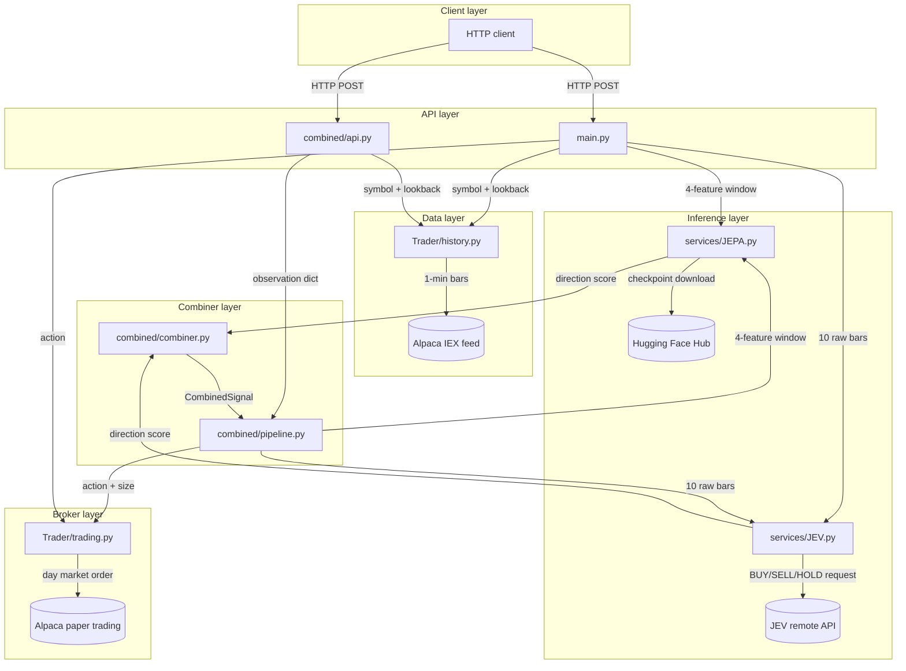

# Architecture

The JEV trading bot is a synchronous FastAPI server. An HTTP client sends a request to one of the API routes; the server fetches 1-minute OHLCV bars from the Alpaca IEX feed, runs them through one or both AI models, and submits a paper market order via the Alpaca trading client. The combined pipeline route coordinates both models through a pure signal-combination layer before making an order decision.

<!-- mermaid-checked: no \n, no em-dash/en-dash, no {} in labels, subgraphs are id["label"], arrows are -->|"label"| -->

The pipeline routes (`/run_trading_pipeline_jepa`, `/combined/predict`) execute synchronously in a loop, sleeping 60 seconds between iterations; `/combined/predict` runs up to 330 iterations and blocks the HTTP connection for up to 330 minutes. Rolling percentile histories for the JEPA and JEV scores are kept in memory inside `CombinedPipeline` and are not persisted across process restarts. The JEPA model and JEV client are each loaded once via `lru_cache` on the first request.

## Main technology choices

- **API layer:** FastAPI, uvicorn, pydantic-settings.
- **JEPA model:** PyTorch 2.8 (CUDA 12.8), `LOBEncoder`, `TransformerEncoder` (norm_first, GELU, batch_first), `DirectionHead`, Hugging Face Hub checkpoint distribution.
- **JEV client:** httpx, OpenAI-compatible chat-completions endpoint, 30-second timeout.
- **Market data:** alpaca-py `StockHistoricalDataClient`, Alpaca IEX feed, 1-minute bars.
- **Order execution:** alpaca-py `TradingClient`, `paper=True`, day market orders.
- **Configuration:** pydantic-settings `BaseSettings` with `.env` file and `AliasChoices` for environment variable aliasing.
- **Testing:** pytest, `monkeypatch`, fake trading client (no live API calls in unit tests).

