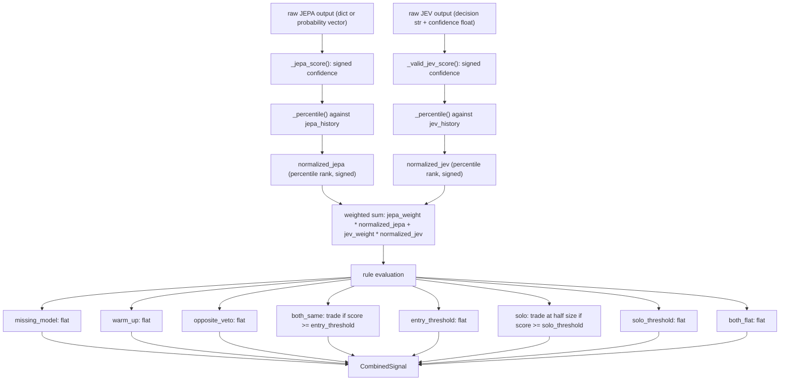

# Combined signal combiner

The combiner is implemented in [`app/combined/combiner.py`](../app/combined/combiner.py). It is a pure module with no IO, no FastAPI imports, and no dependency on live market data; it can be unit-tested in isolation without a running server or external API.

<!-- mermaid-checked: no \n, no em-dash/en-dash, no {} in labels, subgraphs are id["label"], arrows are -->|"label"| -->

## Configuration

`CombinerConfig` is a frozen dataclass with the following fields:

- `window` — number of prior score magnitudes to retain in each rolling history list (default: `500`).
- `jepa_weight` — weight applied to the percentile-normalized JEPA score when computing the combined score (default: `0.5`).
- `jev_weight` — weight applied to the percentile-normalized JEV score (default: `0.5`).
- `entry_threshold` — minimum combined score magnitude required for a `both_same` trade signal (default: `0.6`).
- `solo_threshold` — minimum single-model score magnitude required for a `solo` trade signal (default: `0.85`).
- `max_size` — maximum fractional position size multiplier applied to the computed order size (default: `1.0`).
- `warmup_period` — minimum history length required before percentile normalization is active; defaults to `max(1, ceil(window / 4))` when `None`.

## Decision rules

Rules are evaluated in the order listed; the first matching rule determines the output:

- `missing_model` — either model returned no parseable score (JEPA output was `None` or malformed; JEV confidence or decision was `None` or non-finite); result is `flat`.
- `warm_up` — either model's rolling history has fewer entries than `warmup_period`; result is `flat`.
- `opposite_veto` — both models have non-zero normalized scores but they point in opposite directions (product is negative); result is `flat`.
- `both_same` — both models have non-zero normalized scores in the same direction and the combined score magnitude is at or above `entry_threshold`; result is `up` or `down` with `size = max_size * abs(combined_score)`.
- `entry_threshold` — both models agree but the combined score magnitude is below `entry_threshold`; result is `flat`.
- `solo` — only one model has a non-zero normalized score and its magnitude is at or above `solo_threshold`; result is `up` or `down` with `size = max_size * abs(directional) / 2` (half size).
- `solo_threshold` — only one model has a non-zero score but its magnitude is below `solo_threshold`; result is `flat`.
- `both_flat` — both models returned flat or hold (normalized scores are zero); result is `flat`.

## Output

`CombinedSignal` is a frozen dataclass with the following fields:

- `action` — one of `"up"`, `"down"`, or `"flat"`.
- `normalized_jepa` — the percentile-normalized, sign-preserved JEPA score.
- `normalized_jev` — the percentile-normalized, sign-preserved JEV score.
- `combined_score` — the weighted sum of `normalized_jepa` and `normalized_jev`.
- `size` — the computed fractional order size (0.0 when action is `"flat"`).
- `rule` — the name of the rule that determined the output.
- `jepa_score` — the raw signed JEPA score before normalization, or `None` if the model output was missing.
- `jev_score` — the raw signed JEV score before normalization, or `None` if the model output was missing.
- `jepa_missing` — `True` if the JEPA output could not be parsed.
- `jev_missing` — `True` if the JEV output could not be parsed.

