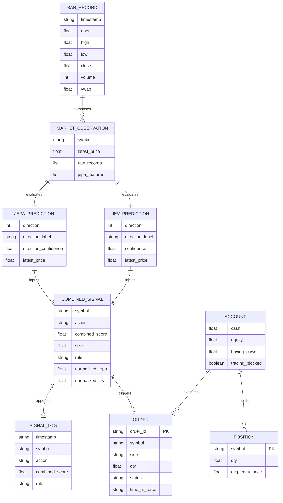

# Database and data models

The application does not use a standalone relational database engine. Instead, data persistence and state management are divided between in-memory rolling feature histories, an append-only JSONL signal log configured via `combined_signal_log_path`, and broker-managed account and order records accessed through the Alpaca paper-trading API.

<!-- mermaid-checked: no \n, no em-dash/en-dash, no {} in labels, subgraphs are id["label"], arrows are -->|"label"| -->

## Data stores and state management

### In-memory rolling history

The `CombinedPipeline` class maintains an in-memory dictionary mapping each uppercase equity symbol to rolling score magnitude lists:

- `histories[symbol]["jepa"]` — a list of prior absolute JEPA direction scores, capped to `COMBINED_PERCENTILE_WINDOW` entries (default 500).
- `histories[symbol]["jev"]` — a list of prior absolute JEV confidence scores, capped to `COMBINED_PERCENTILE_WINDOW` entries (default 500).
- These lists reset when the server restarts; they are not written to disk.

### Signal log file

When signal logging is enabled, predictions are appended as newline-delimited JSON (JSONL) records to the path defined by `combined_signal_log_path` (default: `data/combined/signals.jsonl`). Each line records the timestamp, symbol, action, scores, rule, and whether orders were submitted.

### Alpaca broker state

All persistent order, position, and account records reside on Alpaca servers and are queried on demand via `alpaca-py`:

- **Account:** queried before placing buy orders to verify that `trading_blocked` is false and `buying_power` is sufficient.
- **Positions:** queried before order placement to determine whether to open, close, or reverse long and short holdings.
- **Orders:** active orders are inspected by `_available_order_quantity()` in [`app/Trader/trading.py`](../app/Trader/trading.py) to prevent submitting duplicate sell or cover orders for shares already committed to pending transactions.

