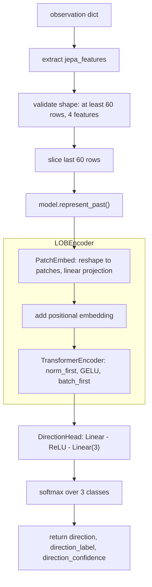

# JEPA service

The JEPA service is implemented in [`app/services/JEPA.py`](../app/services/JEPA.py). It loads a trained PyTorch checkpoint, encodes a 60-step market feature window using a patch-embedding transformer, and classifies the near-term price direction as down, flat, or up.

<!-- mermaid-checked: no \n, no em-dash/en-dash, no {} in labels, subgraphs are id["label"], arrows are -->|"label"| -->

## Model architecture

- `LOBEncoder` divides the input sequence into non-overlapping patches of a fixed length, projects each patch through a linear layer (`PatchEmbed`), and adds learned positional embeddings before passing the token sequence to `TransformerEncoder`.
- `TransformerEncoder` stacks `nn.TransformerEncoderLayer` blocks with `norm_first=True`, GELU activation, and `batch_first=True`; each block is followed by a final `LayerNorm`.
- `DirectionHead` takes the mean of patch representations along the sequence dimension and classifies through two linear layers with a ReLU in between, producing three logits (down, flat, up).
- `JEPAInference.encode_observation()` requires `jepa_features` to have at least 60 rows and exactly the number of features the model was trained with (4 by default: `log_return`, `bar_range`, `vwap_dist`, `log_vol_change`).
- Inference runs under `torch.inference_mode()` to disable gradient computation.
- The device is selected automatically: CUDA if available, otherwise CPU; it can be overridden by passing a `device` argument to `JEPAInference.__init__()`.

## Checkpoint loading

- When `JEPA_CHECKPOINT` is set in `.env`, the model loads from that local file path and skips the Hugging Face download.
- When `JEPA_CHECKPOINT` is not set, `download_checkpoint()` calls `huggingface_hub.hf_hub_download` to fetch `model.pt` from the `sujalgawas/jepa-trading-direction-small` repository into the Hub cache.
- `HUGGINGFACE_KEY` must be set if the Hub repository is private or gated.
- Two checkpoint formats are supported: a combined state dict where `direction_head.*` keys are embedded directly, and a split format with a separate `"direction_head"` key alongside the base model state dict.
- `download_checkpoint()` raises `FileNotFoundError` on any Hub download failure, with a message indicating whether `HUGGINGFACE_KEY` may be needed.

