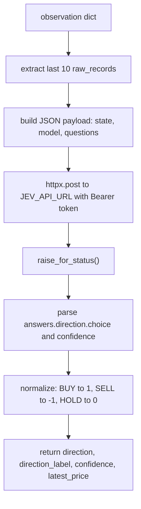

# JEV service

The JEV service is implemented in [`app/services/JEV.py`](../app/services/JEV.py). It sends the most recent 10 raw minute bars from a market observation to a remote language-model API and parses a BUY, SELL, or HOLD decision with an associated confidence score.

<!-- mermaid-checked: no \n, no em-dash/en-dash, no {} in labels, subgraphs are id["label"], arrows are -->|"label"| -->

## Configuration and behavior

- `JEV_API_URL`, `JEV_API_KEY`, and `JEV_MODEL` are read from environment variables via `app/config.py`; `JEV_API_URL` must be set or the inference wrapper raises `ValueError` at initialization time in `app/main.py`.
- The request payload wraps the market state under a `"state"` key (containing `symbol`, `latest_price`, and `latest_minute_bars`) and poses a single structured question (`"direction"`) with `BUY`, `SELL`, and `HOLD` as labeled criteria.
- The HTTP request uses a 30-second timeout; a network error or timeout propagates as an `httpx` exception to the caller.
- A non-2xx HTTP response raises `ValueError` with the status code and the first 500 characters of the response body.
- An unrecognized choice string in the API response raises `ValueError` with the returned label.
- `predict_signal(history, observation)` returns the direction as a bare `float` (`1.0`, `-1.0`, or `0.0`) so it can be passed directly to `run_trading_pipeline_jepa()` as the `predict_signal` callable.

