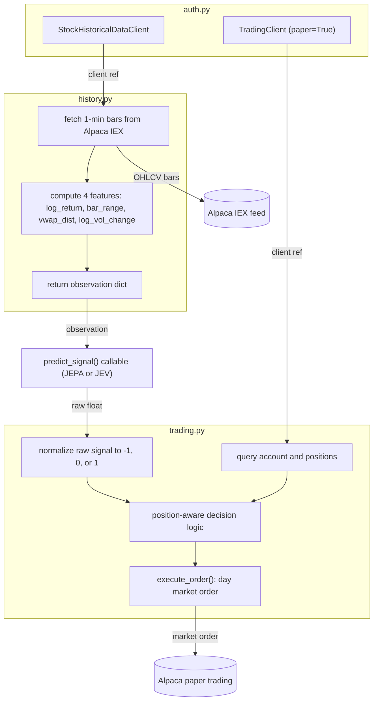

# Trader module

The `app/Trader/` directory contains four modules that handle Alpaca authentication, 1-minute bar fetching and feature engineering, account queries, and position-aware order execution. These modules are shared by both the standalone JEPA/JEV routes in `app/main.py` and the combined pipeline in `app/combined/pipeline.py`.

<!-- mermaid-checked: no \n, no em-dash/en-dash, no {} in labels, subgraphs are id["label"], arrows are -->|"label"| -->

## Modules

### `auth.py`

- `get_data_client_key()` creates a `StockHistoricalDataClient` using `ALPACA_API_KEY` and `ALPACA_SECRET_KEY` from settings; this client is used exclusively for read-only market data requests.
- `get_trading_client_key()` creates a `TradingClient` with `paper=True`, which routes all order submissions to the Alpaca paper-trading environment.

### `history.py`

- `get_market_observation()` requests 1-minute bars for the window `[end - lookback_minutes - 2 min, end]`; the 2-minute buffer accommodates the incomplete current minute that Alpaca may return.
- Bar data is retrieved from the Alpaca IEX feed (`DataFeed.IEX`) using `StockBarsRequest` with a `TimeFrame(1, TimeFrameUnit.Minute)` resolution.
- Four stationary features are computed per bar: `log_return` (log of close/close_prev), `bar_range` ((high - low) / close), `vwap_dist` ((close - vwap) / vwap), and `log_vol_change` (log(volume + 1) - log(volume_prev + 1)).
- The function raises `ValueError("Insufficient market data returned from provider.")` if fewer than 10 bars are returned, which triggers the off-hours historical fallback in the caller.

### `portfolio.py`

- `get_trading_data()` calls `TradingClient.get_account()` and returns a dict of account cash, equity, buying power, and trading block status; it is exposed via the `GET /test_env` route.

### `trading.py`

- `run_trading_pipeline_jepa()` accepts a `predict_signal` callable that returns a bare float; the function normalizes the value to a direction signal by comparing it against the current price (absolute price mode), interpreting values in the range (-1, 1) as directional or percentage-return signals, and treating exact equality with the current price as neutral.
- Signal +1 and an existing short position: buys to cover the full short quantity after checking for open buy orders.
- Signal +1 and no existing position: opens a new long after verifying sufficient buying power.
- Signal +1 and an existing long position: holds and returns `{"action": "hold", "reason": "holding_existing_position_on_up_signal"}`.
- Signal -1 and no existing position: opens a short by submitting a sell order.
- Signal -1 and an existing long position: sells to close after checking for open sell orders and available quantity.
- Signal 0: returns `{"action": "hold", "reason": "neutral_signal"}` without querying the broker.
- `execute_order()` submits a `MarketOrderRequest` with `TimeInForce.DAY` and returns a dict with `action`, `symbol`, `quantity`, `order_id`, and `status`.

